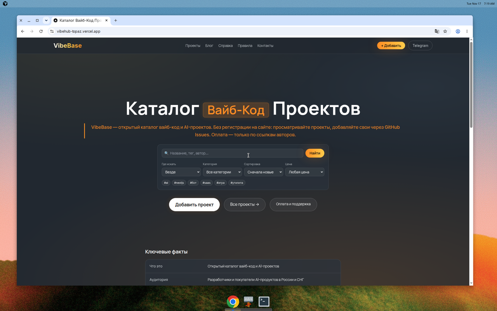

# VibeBase

> Каталог vibe-code и AI-проектов: найти / отфильтровать / открыть карточку — без обязательной регистрации на проде.

## Demo
- **Production:** https://vibehub-topaz.vercel.app  
- **Исходники:** private (`paskal635-maker/vibebase`) — по запросу walkthrough / invite

## Стек (названия)
Next.js · React · TypeScript · Prisma · PostgreSQL · Docker · GitHub Actions · Vercel / Neon

## UI (что видит рекрутер на demo)
- Тёмный лендинг с брендом **VibeBase** и навигацией каталога  
- Hero: «Каталог Вайб-Код Проектов», поиск и фильтры (категория / сортировка / цена)  
- Теги технологий (`#ai`, `#nextjs`, `#saas`, …) и CTA «Добавить проект» / «Все проекты»  
- Каталог открыт для просмотра; платежи/личный кабинет на проде сужены (directory / STATIC_ONLY)

## Роль автора
Fullstack: UI каталога, API/данные, CI/CD, Docker, production-деплой и compliance-tradeoff (каталог без лишнего сбора ПДн).

## AI-практика (одна фраза)
Тема продукта — vibe coding; скорость итераций с Cursor закрыта жёсткими CI/security гейтами до кликабельного production.

## Честность
- Live demo публичен; **репо остаётся private** (полный platform-код не выкладываем).  
- На проде сознательно урезан scope относительно «полного marketplace» в пользу безопасной витрины.
